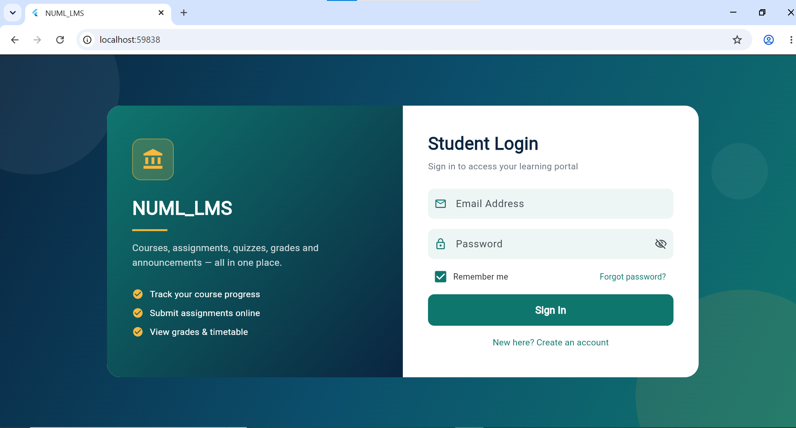
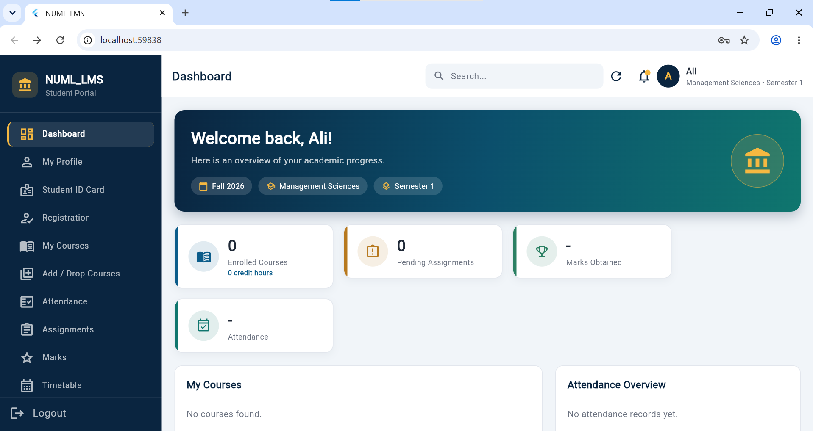
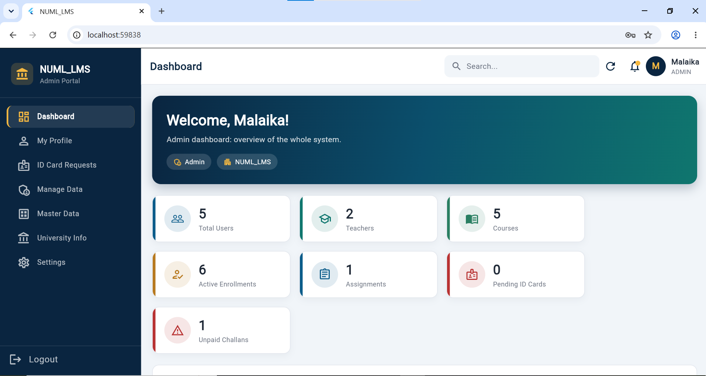
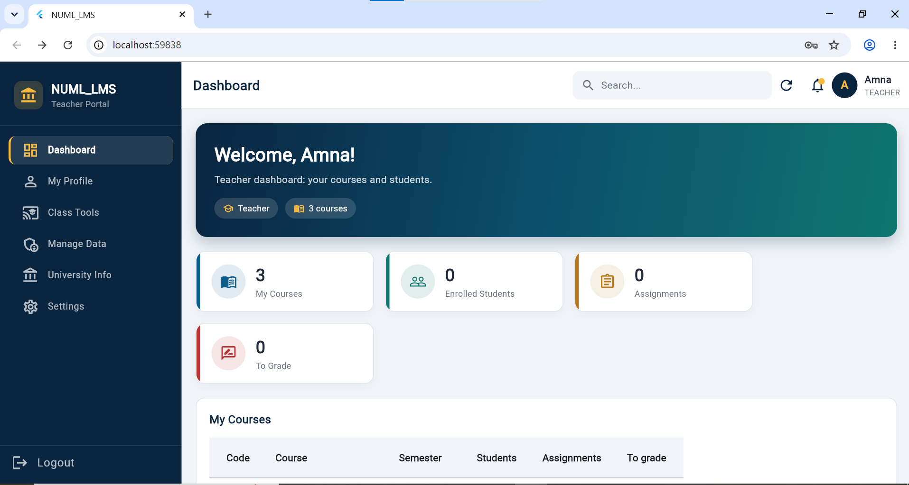

# NUML_LMS: University Learning Management System

A full-stack, role-based LMS built with **Flutter**, **Node.js / Express** and **MongoDB**. Students, teachers and admins each get their own dashboard and permissions, and every record created in the app is saved directly to MongoDB.

## Screenshots

> Add 3 to 4 screenshots here (login, student dashboard, admin Manage Data, teacher Class Tools).
>
> ```md




> ```

## Tech Stack

| Layer | Technology |
|---|---|
| Frontend | Flutter (Web, Android, iOS) |
| Backend | Node.js, Express, Mongoose driver |
| Database | MongoDB (viewed with MongoDB Compass) |
| Auth | JWT (12 h) + bcrypt password hashing |

## Features

**Authentication and security**
- Sign up, sign in, change password, profile editing
- bcrypt-hashed passwords, JWT-protected API, login and signup rate limiting
- Role-based access control enforced on the server (not just hidden in the UI)

**Student**
- Add / drop courses (with a credit-hour limit)
- View and submit assignments, see grades and teacher feedback
- Attendance, marks, timetable, exam slip, fee challans, announcements
- Request an ID card and semester registration

**Teacher**
- Dashboard with assigned courses, enrolled students and submissions to grade
- Class Tools: mark attendance and enter marks for a whole class at once
- Create assignments and announcements, grade submissions
- Can only access the courses assigned to them

**Admin**
- Dashboard with system-wide statistics
- Approve or reject ID card requests
- Manage Data: add, edit and delete records in every collection
- Assign teachers to courses and set user roles

## Dynamic forms

The backend defines each collection once in a `SCHEMA` object. From that single definition the server validates input, and the Flutter **Manage Data** screen builds its forms automatically (text, number, date, dropdown and reference fields). Adding a new field or collection takes one line in `SCHEMA`, with no Flutter changes.

## Project Structure

```
flutter_application_1/
├── lib/
│   ├── main.dart            # all screens
│   └── api_service.dart     # API calls (http)
├── lms_backend/
│   ├── server.js            # Express API, auth, roles, schema
│   └── seed_enrollments.js  # one-time migration helper
└── pubspec.yaml
```

## Getting Started

### Prerequisites
- Node.js 18+
- Flutter SDK
- MongoDB running locally (`mongodb://localhost:27017`)

### 1. Backend
```bash
cd lms_backend
npm install express mongoose cors bcryptjs jsonwebtoken
node server.js
```
The API runs on `http://localhost:3000` and uses the `NUML_LMS` database.

### 2. Frontend
```bash
flutter pub get
flutter run -d chrome
```

### 3. First admin
Add your email to `ADMIN_EMAILS` in `server.js`, sign up in the app, then use **Manage Data** to give other users the `teacher` role and assign them to courses.

## Roadmap
- Course materials (file upload)
- Quizzes with auto-grading
- GPA / result card with PDF export
- Fee challan generation
- Notifications, dark mode and charts

## Author
**Bisma Rajput** · BS Computer Science, NUML Hyderabad